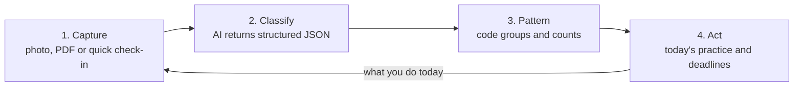

# Buclo

**Turn your mistakes into spaced practice.**

Buclo (from the Spanish *bucle*, "loop") is a study feedback app. You snap a photo of a mistake from an exam or problem set, AI classifies what went wrong, and Buclo finds your patterns and schedules practice right before your next test.

> 🚧 **Status:** in active development, week 0 of 10. Built 1 hour a day alongside my first year of Computer Science at the University of Toronto Mississauga.

---

## Why

I kept a mistake log on paper: what I wrote, what the answer was, and why I got it wrong. It helped, but a notebook never talks back. It doesn't tell you that most of your calculus errors are sign errors, or remind you to practice them before the midterm.

Buclo closes that loop.

## How it works



**Design rule: the AI understands, the code decides.**
The model does only what code can't do: read handwriting and interpret a mistake. Counting, scheduling, dates and grades are plain code, because they must be exact.

## Features (MVP)

- [ ] Capture a mistake from a photo or text
- [ ] AI classification into a fixed taxonomy (concept, algebra, misread question, edge case, missing justification, notation)
- [ ] Human confirmation before anything is saved
- [ ] Patterns dashboard: most frequent error types per course
- [ ] AI-generated "twin" practice problems
- [ ] Spaced repetition scheduling (SM-2)
- [ ] **Today** screen: what to practice and what's due
- [ ] Syllabus PDF → deadlines and weights, exportable to calendar (.ics)
- [ ] Daily check-in for 3 personal habits and an AI-written weekly review

## Tech stack

| Layer | Technology |
|---|---|
| Frontend | React + Vite |
| Backend | Node.js + Express |
| Database | MongoDB Atlas + Mongoose |
| AI | Claude API (vision + tool use for structured output) |
| Validation | Zod |
| Images | Cloudinary |
| Auth | Clerk (magic link) |
| Reminders | Render Cron Jobs + Resend |
| Testing | Vitest + an evaluation script for AI accuracy |
| Deploy | Vercel (client) + Render (server) |

## Evaluating the AI

AI features are only as good as their measurement. `eval/` contains real mistakes I labeled by hand. A script runs each one through the classifier and reports accuracy, so every prompt change is measured, not guessed.

| Metric | Result |
|---|---|
| Classification accuracy | _coming in week 5_ |

## Data model

```text
users     { email, name, timezone }
entries   { userId, kind: "mistake" | "deadline" | "habit", course, topic,
            category, rootCause, imageUrl, originalText, confirmed, createdAt }
practice  { entryId, question, solution, dueDate, interval, ease, reps }
courses   { userId, code, components: [{ name, weight, dueDate }] }
checkins  { userId, habit, date, done, note }
```

## Project structure

```text
buclo/
├── client/   # React + Vite frontend
├── server/   # Express API
├── eval/     # labeled test set + accuracy script
└── docs/     # notes and decisions
```

## Getting started

```bash
git clone https://github.com/Juan-B0i/buclo.git
cd buclo

# server
cd server
cp .env.example .env   # add your own keys
npm install
npm run dev

# client (new terminal)
cd client
npm install
npm run dev
```

## Roadmap

- [ ] **Week 1:** skeleton, database and deploy
- [ ] **Week 2:** data model, create and list mistakes
- [ ] **Week 3:** text → AI classification with validation
- [ ] **Week 4:** photo → classification *(milestone)*
- [ ] **Week 5:** evaluation set and accuracy metric
- [ ] **Week 6:** patterns dashboard
- [ ] **Week 7:** twin problems, spaced repetition, Today screen
- [ ] **Week 8:** syllabus import and calendar export
- [ ] **Week 9:** habits, weekly review and email reminders
- [ ] **Week 10:** polish, first real users and demo video *(milestone)*

## Academic integrity

Buclo is for practice and for reviewing work that has already been graded. Please don't use it on assignments that count toward your grade.

## Dev log

| Date | What I did |
|---|---|
| Nov 2026 | Picked the idea, named it, created the repo |

---

Built by **Juan José Rincón Martínez**, Computer Science at UTM.
